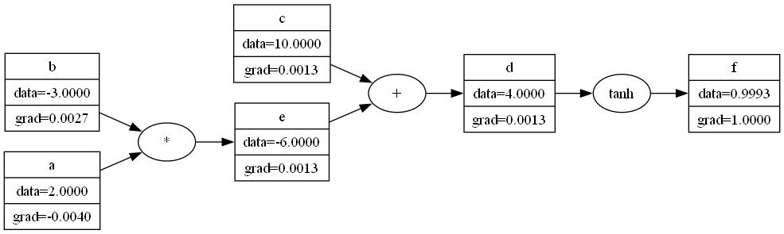
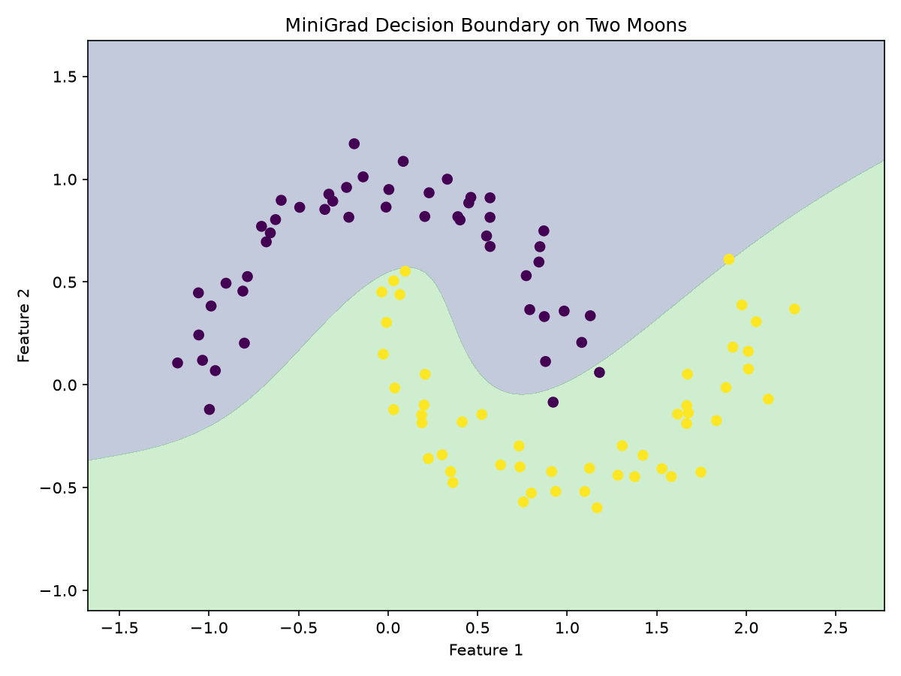
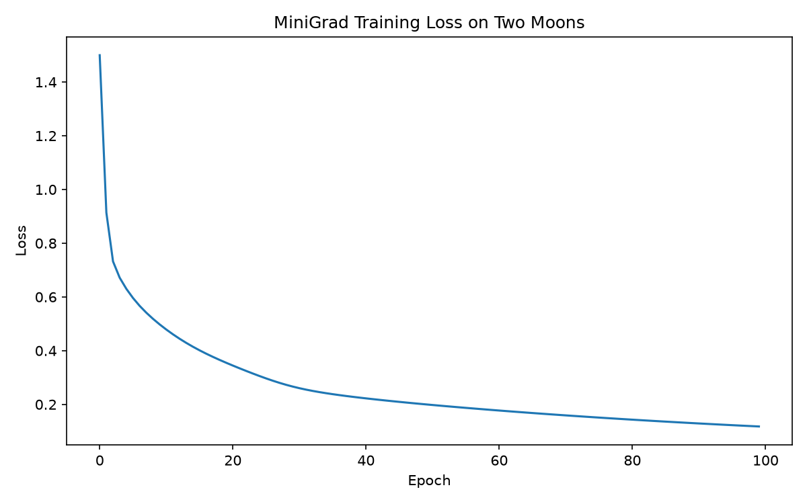
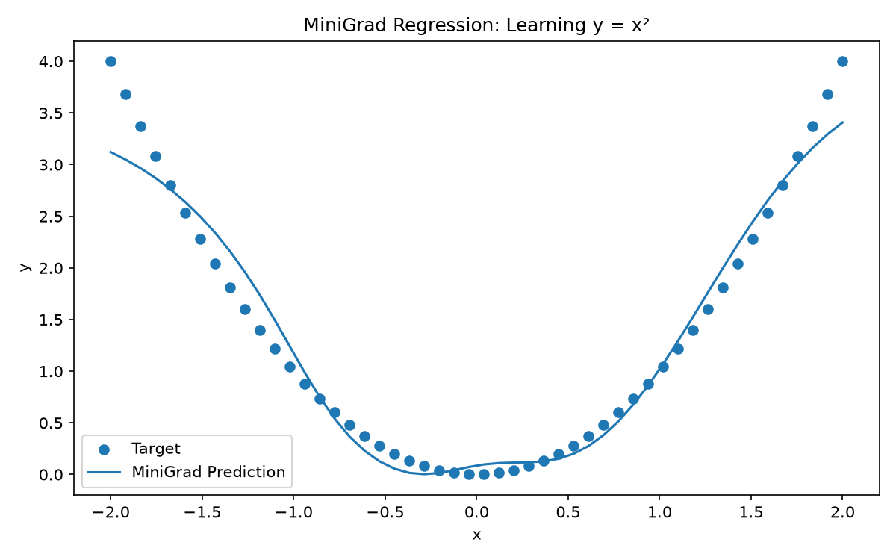
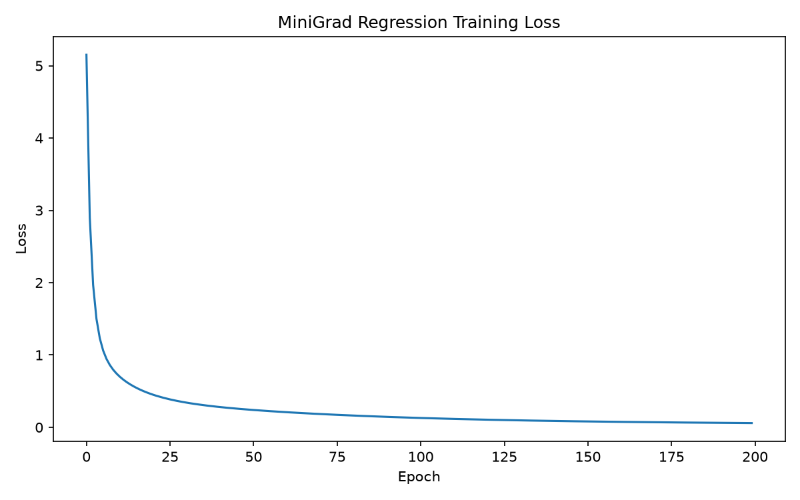

# MiniGrad

MiniGrad is a small autograd and neural network engine I built in Python to understand backpropagation from the ground up.

Instead of using PyTorch to handle gradients and training, the core of MiniGrad builds a computation graph, calculates gradients with reverse-mode autodiff, and updates neural network parameters using SGD.

The engine works with scalar values, so it is not meant to compete with real deep learning frameworks. The point of the project was to understand what is actually happening when we call things like `loss.backward()` and `optimizer.step()`.

## What I implemented

- A `Value` class that builds a computation graph
- Reverse-mode automatic differentiation
- Gradient accumulation and backpropagation
- `+`, `-`, `*`, `/`, powers and `exp`
- `tanh`, ReLU and linear activations
- `Neuron`, `Layer` and `MLP`
- Configurable hidden/output activations
- SGD optimizer
- Numerical gradient checking
- Computation graph visualization
- Classification and regression examples
- PyTorch gradient comparison
- 20 automated tests

## Example

```python
from minigrad.engine import Value

a = Value(2.0)
b = Value(-3.0)
c = Value(10.0)

y = (a * b + c).tanh()
y.backward()

print(y.data)
print(a.grad)
print(b.grad)
print(c.grad)
```

Every operation creates another `Value` and keeps track of the values that produced it. When `backward()` is called, MiniGrad walks through the graph in reverse topological order and applies the local derivatives using the chain rule.

## Computation graph

I added a Graphviz visualization to make it easier to see both the forward values and the gradients calculated during backpropagation.



For this example, the forward expression is:

```text
e = a * b
d = e + c
f = tanh(d)
```

After calling `f.backward()`, each node in the graph contains its gradient with respect to the final output.

## Neural networks

The neural network side is built using three classes:

```text
Neuron -> Layer -> MLP
```

For example:

```python
from minigrad.nn import MLP

model = MLP(3, [4, 4, 1])
```

creates a network with 3 inputs, two hidden layers of 4 neurons each, and one output neuron.

Hidden and output activations can be chosen separately:

```python
model = MLP(
    1,
    [16, 16, 1],
    activation="tanh",
    output_activation="linear"
)
```

This became useful when I added regression, since a `tanh` output would restrict predictions to the range `[-1, 1]`.

## Training

I separated parameter updates into a small SGD optimizer:

```python
from minigrad.optim import SGD

optimizer = SGD(model.parameters(), lr=0.05)

optimizer.zero_grad()
loss.backward()
optimizer.step()
```

The optimizer itself is intentionally simple. The goal here is to keep the training process visible rather than hide it behind a larger API.

## Two Moons classification

I trained a `2 -> 16 -> 16 -> 1` MLP on 100 samples from the Two Moons dataset.

The model has 337 trainable parameters and uses `tanh` activations. I mapped the labels from `0/1` to `-1/+1` so they match the range of the output activation.

Results:

| | Start | Final |
|---|---:|---:|
| Loss | 1.4999 | 0.1178 |
| Accuracy | 51% | **97%** |



The interesting part for me was seeing the network go from an almost random classifier to learning the curved boundary between the two moons using only my own autograd and SGD implementation.

### Training loss



## Regression

I also wanted to check that the same engine could do something other than classification.

For this example, the network learns:

```text
y = x²
```

I used a `1 -> 16 -> 16 -> 1` network with `tanh` hidden layers and a linear output.

The model has 321 trainable parameters.

The MSE went from:

```text
5.1512 -> 0.0584
```



The model is not a perfect fit near the ends of the range, but it captures the quadratic relationship well.

### Regression loss



## Checking the gradients

Since the whole project depends on getting gradients right, I didn't want to rely only on seeing the loss decrease.

There are currently 20 pytest tests covering the autograd operations, gradient accumulation, the neural network classes, SGD and an end-to-end learning test.

Run them with:

```bash
python -m pytest -v
```

Current result:

```text
20 passed
```

I also implemented a finite-difference gradient check:

```python
def numerical_gradient(f, x, h=1e-6):
    return (f(x + h) - f(x - h)) / (2 * h)
```

and compared MiniGrad against PyTorch autograd.

For:

```text
y = tanh(a * b + c)
```

using `float64` in PyTorch:

| | MiniGrad | PyTorch |
|---|---:|---:|
| Output | 0.999329299739067 | 0.999329299739067 |
| `dy/da` | -0.0040228520490775965 | -0.0040228520490775965 |
| `dy/db` | 0.002681901366051731 | 0.002681901366051731 |
| `dy/dc` | 0.0013409506830258655 | 0.0013409506830258655 |

For this test expression, the values and gradients matched PyTorch at the displayed precision.

PyTorch is only used for this comparison. It is not used by MiniGrad for forward passes, backpropagation, or training.

## Project structure

```text
minigrad/
│
├── minigrad/
│   ├── engine.py
│   ├── nn.py
│   ├── optim.py
│   └── visualize.py
│
├── examples/
│   ├── moons.py
│   ├── regression.py
│   ├── graph_demo.py
│   └── pytorch_validation.py
│
├── tests/
│   ├── test_gradients.py
│   └── test_nn.py
│
├── notebooks/
│   └── from_scratch.ipynb
│
├── images/
│   ├── computation_graph.png
│   ├── decision_boundary.png
│   ├── loss_curve.png
│   ├── regression_fit.png
│   └── regression_loss.png
│
├── README.md
├── requirements.txt
└── LICENSE
```

## Setup

Clone the repository and create a virtual environment:

```bash
git clone <repository-url>
cd minigrad
python -m venv .venv
```

On Windows PowerShell:

```powershell
.\.venv\Scripts\Activate.ps1
```

Install the dependencies:

```bash
pip install -r requirements.txt
```

Run the tests:

```bash
python -m pytest -v
```

Run the Two Moons example:

```bash
python -m examples.moons
```

Run the regression example:

```bash
python -m examples.regression
```

Generate the computation graph:

```bash
python -m examples.graph_demo
```

## Limitations

MiniGrad works with scalars rather than tensors, so it is slow compared with actual deep learning frameworks. There is no batching, GPU support, model serialization, or large collection of optimizers and loss functions.

Those are possible extensions, but I want to keep the core small enough that I can still follow the complete forward and backward pass.

## Things I want to add

- Adam and momentum SGD
- More loss functions
- Sigmoid and log operations
- A common `Module` base class
- Model save/load
- More gradient validation cases
- Eventually, tensor operations

## Acknowledgment

I started this project while learning backpropagation from Andrej Karpathy's micrograd material. The scalar autograd design is inspired by micrograd.

After learning the basic implementation, I extended it into this project with a separate neural network module, configurable activations, an SGD optimizer, automated tests, numerical gradient checking, classification and regression examples, computation graph visualization, and PyTorch validation.

The goal wasn't to recreate a production framework. It was to make sure I could build and explain the pieces behind one.